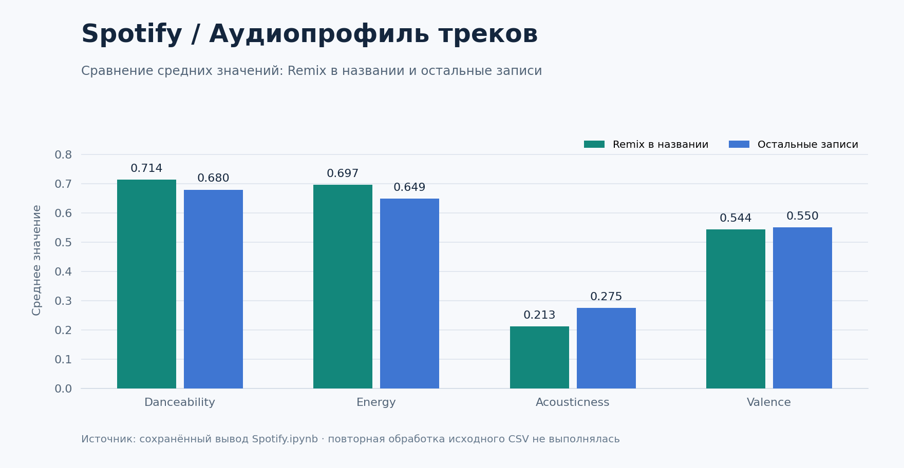

# Spotify Charts Analysis

**Исследование музыкальных чартов: аудиохарактеристики, популярность и различия между странами.**

Python · Pandas · SciPy · Plotly · Jupyter

Проект исследует, как темп, тип трека, регион и время релиза связаны с характеристиками музыки в чартах Spotify. Основной результат — [аналитический ноутбук](Spotify.ipynb) с шестью исследовательскими гипотезами, интерактивными графиками и статистическими проверками.



*Превью построено по сохранённым результатам ноутбука; исходный датасет повторно не обрабатывался.*

## Что сделано

- Проверка структуры данных, удаление дубликатов и строк с пропусками.
- Сравнение популярности треков в группах по темпу: распределения, средние значения и ANOVA.
- Сравнение треков с `Remix` в названии и остальных записей по четырём аудиопризнакам.
- Анализ стран и регионов: карта, корреляционные матрицы, сравнение средних.
- Анализ дня недели, сезона релиза и изменений признаков по годам выпуска.
- Использование t-тестов, в том числе теста Уэлча, и линейной регрессии.

## Примеры результатов

Сохранённый вывод ноутбука описывает **1 703 961 строку после очистки и 25 исходных столбцов**. Строки — наблюдения в чартах; это не число уникальных композиций.

| Показатель | Remix в названии | Остальные записи |
|---|---:|---:|
| Danceability, среднее | 0,714 | 0,680 |
| Energy, среднее | 0,697 | 0,649 |
| Acousticness, среднее | 0,213 | 0,275 |
| Valence, среднее | 0,544 | 0,550 |

Гипотеза о большей позитивности музыки в выходные не подтвердилась в сохранённом расчёте: средняя `valence` составила около 0,549 против 0,551 в будни. Малое p-value при большой выборке следует оценивать вместе с величиной эффекта.

## Как посмотреть

Откройте [Spotify.ipynb](Spotify.ipynb). Если GitHub не отображает большой файл или интерактивную графику, скачайте репозиторий и откройте ноутбук в JupyterLab. Основной файл занимает около 59 МБ из-за сохранённых выводов.

## Локальный запуск

Рекомендуемая версия Python: **3.11 или 3.12**. Команды выполняются в корне проекта.

```bash
git clone https://github.com/Ilush1k/spotify-charts-analysis.git
cd spotify-charts-analysis
python -m venv .venv
```

Активируйте окружение:

```powershell
# Windows PowerShell
.\.venv\Scripts\Activate.ps1
```

```bash
# macOS / Linux
source .venv/bin/activate
```

```bash
python -m pip install -r requirements.txt
python -m jupyter lab
```

Поместите `Top_spotify_songs.csv` рядом с ноутбуком, откройте его и выполните **Restart Kernel and Run All Cells**. Исходный CSV в репозитории отсутствует; без него можно изучать сохранённые результаты. Состав входных данных описан в [docs/DATA.md](docs/DATA.md).

## Структура

```text
Spotify.ipynb          Основное исследование и интерактивные графики
requirements.txt       Зависимости для работы с ноутбуком
docs/DATA.md           Описание входного CSV и ограничений анализа
docs/preview.png       Превью сохранённых результатов
```

## Границы интерпретации

Это исследовательский анализ наблюдений из чартов. Повторные появления одних треков в разных странах и датах могут нарушать независимость наблюдений для статистических тестов. Сравнение групп `Remix` / остальных записей не является попарным сравнением ремикса с оригиналом. В первых двух разделах код не отбирает отдельно акустические треки, хотя исходные формулировки гипотез упоминают их. Анализ по году выпуска описывает состав выборки чартов, а не всю музыку соответствующего года.

Автор: [Ilush1k](https://github.com/Ilush1k).
